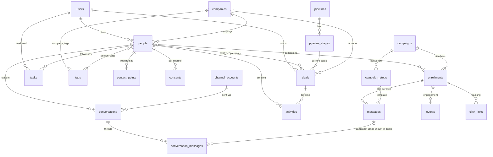

# Database design

Postgres 16 in production (SQLite only for the test suite). SQLAlchemy models live in
[`app/models.py`](../app/models.py); versioned migrations in [`app/migrations/`](../app/migrations/).

## Shape



### CRM core

| Table | Purpose | Notes |
|---|---|---|
| `people` | A real person (CRM contact) | `email` (unique, lower-case) and `phone` (E.164) mirror the primary contact points for fast lookup and sorting. `lifecycle_stage`, `lead_status`, `owner_id`, `do_not_contact`. Flexible data in `attributes` (JSONB). |
| `companies` | Accounts | `domain` unique (NULL allowed) - the key used to match imports, websites and email domains. |
| `contact_points` | Every email address / phone / WhatsApp number / profile of a person | Unique `(kind, value)`: an inbound email or WhatsApp message maps to exactly one person. `status` tracks bounced / invalid identities. |
| `consents` | Opt-in / opt-out per person per channel | Unique `(person_id, channel)`. Email opt-out stops all campaigns; WhatsApp needs its own opt-in. |
| `tags`, `person_tags`, `company_tags` | Labels | Explicit many-to-many tables (can carry `created_at`), shared tag vocabulary. |
| `custom_fields` | Definitions of extra fields for people / companies / deals | Values are stored typed in the record's `attributes` JSONB under the field key; GIN indexes make them filterable. Hybrid model = no ALTER TABLE per customer field, still validated and documented. |
| `pipelines`, `pipeline_stages` | Sales processes | Stage `kind` = open / won / lost; `probability` drives the weighted forecast. |
| `deals`, `deal_people` | Opportunities | `amount NUMERIC(14,2)` + `currency`; `deal_people` is M2M with a `role` (decision maker, champion...). |
| `activities` | Timeline entries: notes, calls, meetings, logged messages | Can point to a person, company and/or deal; index `(person_id, occurred_at)`. |
| `tasks` | Follow-ups | Partial index on open tasks by due date. |

### Engagement (omnichannel)

| Table | Purpose |
|---|---|
| `channel_accounts` | The SMTP mailbox, WhatsApp Business numbers, ... (secrets stay in env; this is identity + config + health). |
| `conversations` | One thread per person per channel (the shared inbox): status, assignee, unread count, `last_inbound_at` (WhatsApp 24-hour window). |
| `conversation_messages` | Every message in/out. Unique `(channel, external_id)` makes webhook retries and IMAP re-reads idempotent. Campaign emails are not copied: the row links to `messages` via `sequence_message_id`. 64-bit id. |
| `webhook_events` | Raw provider callbacks with unique `(provider, external_id)` - deduplication, replay and debugging. |

### Outreach

| Table | Purpose |
|---|---|
| `campaigns`, `campaign_steps` | Email sequences. |
| `enrollments` | A person in a campaign (was `contacts`). Campaign state only: stage, next due time, flags; the send-to `email`; campaign-specific merge `variables` (JSONB). Unique `(campaign_id, person_id)`. |
| `messages` | One per enrollment per step: per-person overrides, delivery state, sent snapshot, tracking tokens. Unique `(enrollment_id, step_id)`. |
| `events`, `click_links` | Engagement log and tracked links (64-bit ids). |
| `suppressions`, `templates`, `settings` | Do-not-contact list (email / domain / phone), reusable texts (email or WhatsApp template refs), runtime settings. |

### Platform

`users` (roles owner / admin / member, hashed passwords), `api_keys` (SHA-256 of the key only, scopes
read / write / send, expiry, revocation), `audit_log` (actor type user / api / mcp / system, action,
entity, JSON diff of changed fields), `schema_migrations`.

## Conventions

* Naive UTC timestamps everywhere; the UI converts to the configured timezone.
* Explicit foreign keys with `ON DELETE` rules: child rows of a campaign / enrollment cascade,
  references to owners and companies are `SET NULL`, deals block deletion of a stage in use.
* Deterministic constraint names (`fk_<table>_<column>_<ref>`, `uq_...`, `ix_...`) so migrations can
  find them.
* JSON only where the shape genuinely varies per customer (custom field values, campaign merge
  variables, provider payloads, audit diffs); everything that is queried, joined or constrained is a
  real column.
* Identities are normalised before storage (lower-case email, E.164 phone, bare domain) so uniqueness
  constraints do the de-duplication.

## Scalability notes

* Hot paths are indexed for their exact predicates: the worker's "what is due" query uses the partial
  index `ix_enrollments_sendable_due`; queued sends use `ix_messages_queued_only`; reply matching uses
  `ix_messages_message_id`.
* Search uses `pg_trgm` GIN indexes on people (name / email / phone) and companies (name / domain) so
  `ILIKE '%term%'` stays fast past millions of rows.
* `attributes` / `variables` have `jsonb_path_ops` GIN indexes for containment filters.
* Append-only tables (`events`, `click_links`, `conversation_messages`, `audit_log`, `webhook_events`)
  use BIGINT keys; they are the candidates for time-based partitioning or archiving when they grow.
* List pages load related rows with `selectinload` (no N+1) and paginate in SQL.
* Next steps when needed: partition `events` / `audit_log` by month, move the worker to
  `SELECT ... FOR UPDATE SKIP LOCKED` for multiple senders, add a `workspace_id` to every table for
  multi-tenancy.

## Migrations

`init_db()` (called by every process at start-up, serialised with a Postgres advisory lock) runs
[`app.migrations.migrate`](../app/migrations/__init__.py):

* empty database: `create_all` from the models, every migration stamped as applied;
* database from before versioning: every migration from the baseline;
* otherwise: only the missing ones, each in its own transaction.

Then it creates the idempotent extras (partial / GIN / trigram indexes) and default rows (sales
pipeline, email channel). `python -m app.manage status` lists applied migrations.

To change the schema: add `app/migrations/v0003_<name>.py` with `VERSION`, `NAME` and
`upgrade(conn)`, append it to `MIGRATIONS`, use the idempotent helpers in `ops.py`, update the model,
and keep `tests/test_migrations.py::test_migrated_schema_matches_fresh_schema` green (it fails when a
migrated database and a fresh one diverge).

`deploy.sh` stores a gzipped `pg_dump` in `backups/` before every deploy. Restore with:

```bash
gunzip -c backups/pre-deploy-XXXX.sql.gz | docker compose exec -T db psql -U mailcampaign mailcampaign
```
(into an empty database).
