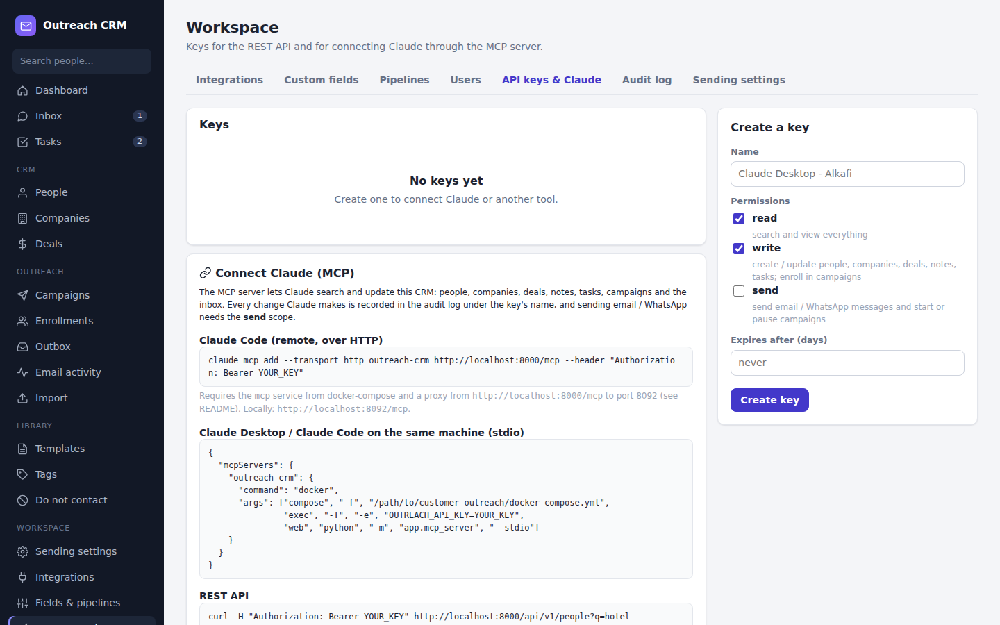

# Connecting Claude (MCP server)

The CRM ships an [MCP](https://modelcontextprotocol.io) server (`app/mcp_server.py`, the `mcp`
container). Once connected, Claude can search and update the CRM, keep the timeline up to date, manage
deals and tasks, enroll people in campaigns, read the inbox and - with your permission - send messages.

## 1. Create an API key

*Workspace > Users & API keys > API keys & Claude > Create a key*



| Permission | Lets Claude... |
|---|---|
| `read` | search and view people, companies, deals, tasks, campaigns, conversations |
| `write` | create / update people, companies, deals, tasks; log notes; merge people; enroll in campaigns |
| `send` | email or WhatsApp people, start / pause / archive campaigns (things that reach real people) |

Start with `read` + `write`. Add `send` only to a key you want Claude to send messages with. The key is
shown **once**; copy it. Keys can expire and be revoked; *Last used* shows activity.

CLI alternative: `docker compose exec web python -m app.manage create-api-key "Claude" --scopes read,write`

## 2. Connect a client

### Claude Code (HTTP)
```bash
claude mcp add --transport http outreach-crm https://YOUR-PANEL-DOMAIN/mcp \
  --header "Authorization: Bearer oc_xxxxxxxx_..."
```
Locally: `http://localhost:8092/mcp`. On the server the `mcp` container listens on `127.0.0.1:8092`;
your reverse proxy forwards `/mcp` to it (see `Caddyfile`).

### Claude Desktop (stdio, on the machine running Docker)
Settings > Developer > Edit config, add:
```json
{
  "mcpServers": {
    "outreach-crm": {
      "command": "docker",
      "args": ["compose", "-f", "/path/to/customer-outreach/docker-compose.yml",
               "exec", "-T", "-e", "OUTREACH_API_KEY=oc_xxxxxxxx_...",
               "web", "python", "-m", "app.mcp_server", "--stdio"]
    }
  }
}
```
Without `OUTREACH_API_KEY` the stdio server runs as "local" with `read,write`
(override with `OUTREACH_MCP_SCOPES`).

### claude.ai (remote connector)
Add a custom connector with URL `https://YOUR-PANEL-DOMAIN/mcp` and the API key as bearer token.
The server must be reachable over HTTPS.

## 3. What Claude can do

| Tool | Permission | Purpose |
|---|---|---|
| `crm_overview` | read | People / companies count, open & weighted pipeline, overdue / due tasks, unread inbox, email stats, active campaigns |
| `search` | read | People, companies and deals at once - always used before creating |
| `list_people` | read | Filter by text, lifecycle stage, tag, company, campaign; paginated |
| `get_person` | read | Full profile by id or email: identities, consent, enrollments, open tasks, deals, timeline |
| `create_person` | write | New person (+ company by name / website); refuses duplicates by email |
| `update_person` | write | Change fields, primary email / phone, lifecycle, lead status, owner, do-not-contact, tags, custom fields |
| `merge_people` | write | Fold a duplicate into another person (irreversible) |
| `list_companies`, `get_company` | read | Accounts with people, deals and recent activity |
| `create_company`, `update_company` | write | Manage accounts |
| `list_pipelines`, `list_deals` | read | Stages and deals, with pipeline summary |
| `create_deal`, `update_deal` | write | Stage by name (`"Proposal sent"`, `"Won"`), amount, close date, contacts, lost reason |
| `log_activity` | write | Note / call / meeting on a person, company or deal |
| `list_tasks`, `create_task`, `update_task` | read / write | Follow-ups: open, today, overdue, done |
| `list_campaigns`, `get_campaign` | read | Campaigns and per-stage funnel |
| `enroll_in_campaign` | write | Add people (ids or emails) to a sequence |
| `set_campaign_status` | **send** | Start / pause / archive a campaign |
| `list_conversations`, `get_conversation` | read | Inbox threads and messages; WhatsApp 24h window status |
| `send_message` | **send** | Email or WhatsApp a person now (respects opt-outs, do-not-contact, 24h rule) |

Prompts: **daily_briefing** (read-only morning summary) and **account_research** (look up an account,
log a summary note, propose a next step).

The server also gives Claude standing instructions: search before creating, prefer updates, log what it
did, never send or start campaigns unless you asked, and how the WhatsApp window works.

## 4. Safety model

* **Every request is authenticated** with an API key (HTTP: `Authorization: Bearer`); invalid, expired
  or revoked keys get `401`.
* **Permissions are checked per tool.** Without `send`, Claude cannot message anyone or start a
  campaign; the error tells it to ask you.
* **Business rules still apply**: opt-outs, do-not-contact, suppression list, WhatsApp window,
  duplicate protection - Claude goes through the same service layer as the panel.
* **Audit**: every change is recorded with actor "mcp: <key name>"; filter *Audit log* by *Claude*.
* Revoke a key at any time; it stops working immediately.
* Optional DNS-rebinding protection for the HTTP server: `MCP_ALLOWED_HOSTS=panel.example.com`.

## 5. Example requests

* "Daily briefing." → `crm_overview`, `list_tasks(overdue/today)`, `list_conversations(unread)`.
* "Who at Harcourt Hotel have we talked to and what's the status?" → `search`, `get_company`,
  `get_person`.
* "Danielle wants pricing: create a €9.5k deal at Proposal sent and remind me Friday 10:00 to follow up."
  → `create_deal`, `create_task`.
* "Add these three emails to the Ireland hospitality campaign." → `enroll_in_campaign`.
* "Reply to Clare on WhatsApp: yes, the offer runs until Friday." → `get_conversation` (window check),
  `send_message` (needs `send`).

## 6. Troubleshooting

| Symptom | Fix |
|---|---|
| `401 unauthorized` | Wrong / revoked / expired key, or missing `Bearer ` prefix |
| "does not have the 'write' / 'send' permission" | Create a key with that permission |
| Claude Desktop shows no tools | Run the `docker compose ... exec` command from the config in a terminal; it must print nothing to stdout before MCP starts. Check `docker compose ps` |
| `curl localhost:8092/healthz` fails | `docker compose logs mcp` |
| Proxy returns 421 / host errors | Remove or correct `MCP_ALLOWED_HOSTS` |

For developers: tools are thin wrappers around `app/crm/actions.py`, which the REST API also uses.
Add a tool by adding an action there and a decorated function in `app/mcp_server.py`; cover it in
`tests/test_mcp.py`.
