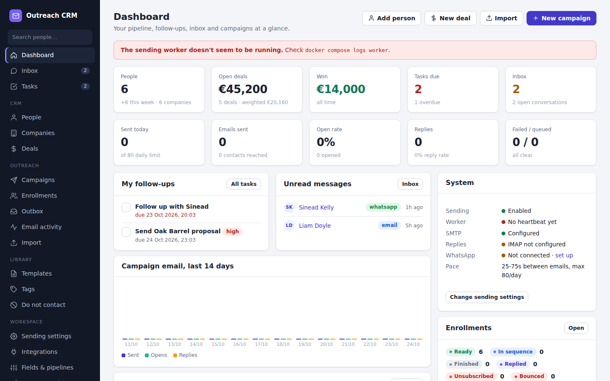
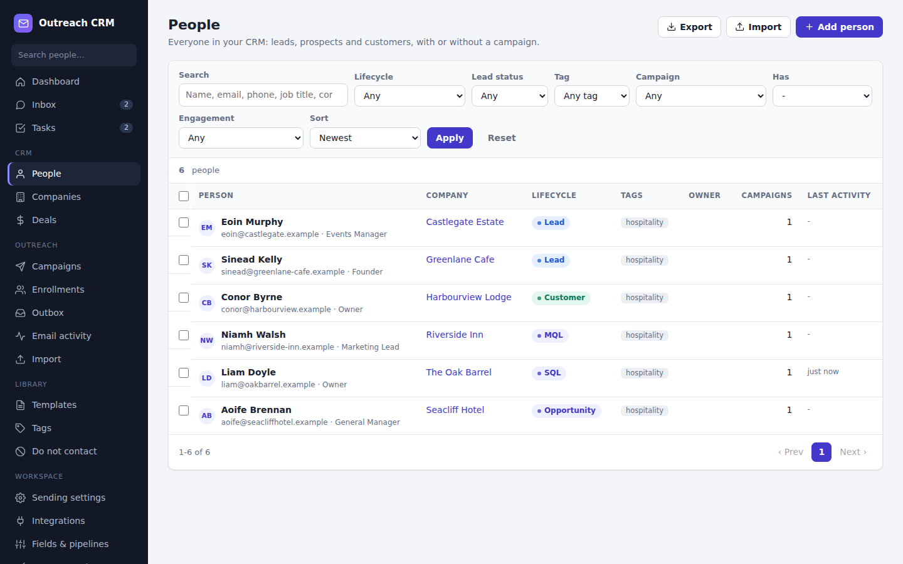
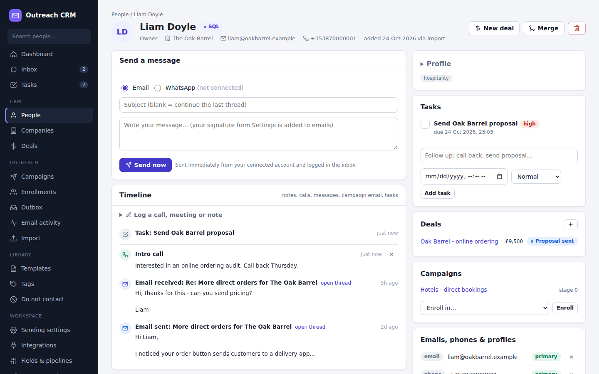
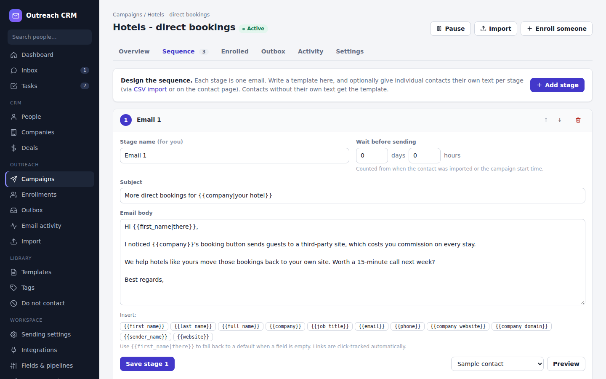
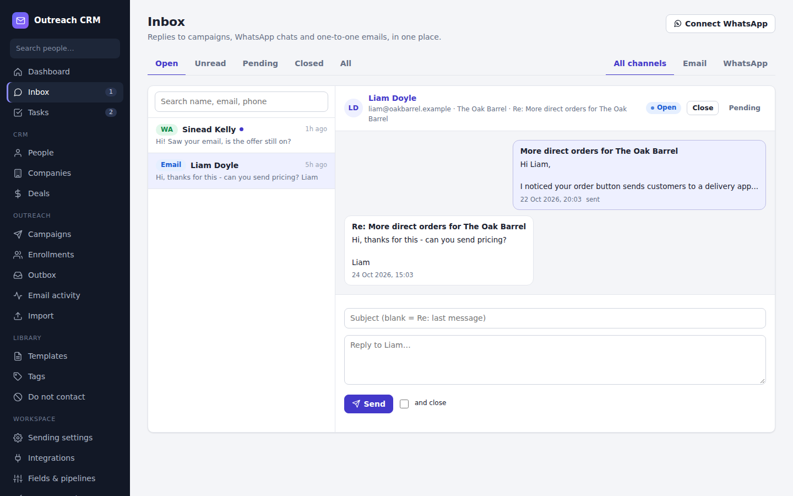
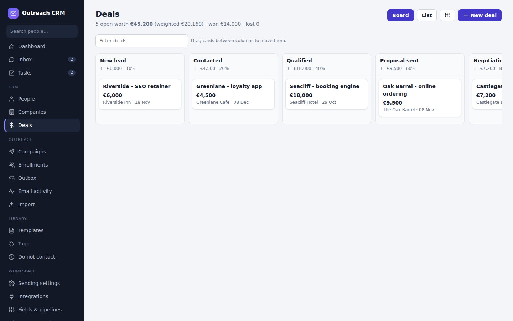
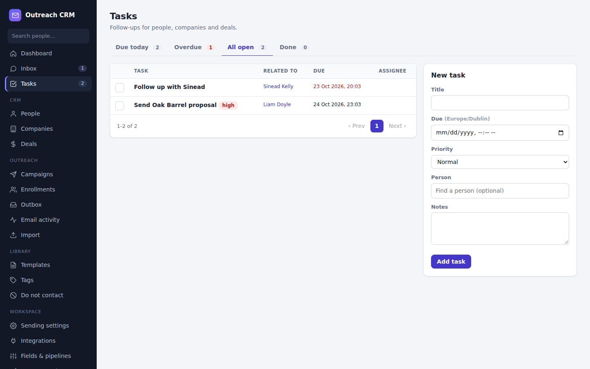

# User guide

Everything you can do in Outreach CRM, from first login to a won deal. No technical knowledge needed.
(Setting up the server is in [OPERATIONS.md](OPERATIONS.md); connecting Claude in [MCP.md](MCP.md).)

- [1. The big picture](#1-the-big-picture)
- [2. First-time setup (15 minutes)](#2-first-time-setup-15-minutes)
- [3. People and companies](#3-people-and-companies)
- [4. Importing a spreadsheet](#4-importing-a-spreadsheet)
- [5. Email campaigns (sequences)](#5-email-campaigns-sequences)
- [6. The inbox: replies, email and WhatsApp](#6-the-inbox-replies-email-and-whatsapp)
- [7. Deals and the pipeline](#7-deals-and-the-pipeline)
- [8. Tasks and the timeline](#8-tasks-and-the-timeline)
- [9. Working with Claude](#9-working-with-claude)
- [10. Opt-outs, bounces and staying compliant](#10-opt-outs-bounces-and-staying-compliant)
- [11. Workspace settings](#11-workspace-settings)
- [12. A typical day](#12-a-typical-day)
- [13. Troubleshooting & FAQ](#13-troubleshooting--faq)
- [Glossary](#glossary)

---

## 1. The big picture



The CRM is built around **people**. Everything else hangs off a person:

```
Company ── People ──┬── Emails / phones / WhatsApp numbers   (how to reach them)
                    ├── Timeline: notes, calls, messages, campaign emails
                    ├── Tasks                                 (what to do next)
                    ├── Deals                                 (money you might make)
                    ├── Conversations in the Inbox            (email + WhatsApp threads)
                    └── Enrollments in campaigns              (automatic email sequences)
```

The left menu follows the same idea:

| Menu | What it is for |
|---|---|
| **Dashboard** | Pipeline value, tasks due, unread messages, campaign stats, system health |
| **Inbox** | Every reply and WhatsApp chat, one thread per person |
| **Tasks** | Your follow-ups (due today, overdue, all, done) |
| **People / Companies** | Your contacts and accounts |
| **Deals** | Sales pipeline as a board or a list |
| **Campaigns / Enrollments / Outbox / Email activity** | Automatic email sequences and what they are doing |
| **Import** | Bring in CSV / Excel lists |
| **Templates / Tags / Do not contact** | Reusable texts, labels, the global block list |
| **Workspace** | Sending settings, integrations, custom fields, pipelines, users, API keys, audit log |

Three rules hold everywhere:

1. **A reply on any channel stops automatic emails** to that person (email reply or WhatsApp message).
2. **Opt-outs are global.** An unsubscribe or "do not contact" blocks every campaign and every channel.
3. **Everything is logged.** Every change (by you, a colleague, the API or Claude) is in the audit log.

## 2. First-time setup (15 minutes)

1. **Sign in** with the admin login from the server's `.env` (ask whoever installed it).
2. **Create your own user**: *Workspace > Users & API keys > Users > Add a user*. The first user becomes
   the **owner**. Sign out and back in with your email. Your name now appears on notes and records
   you create, and records can be assigned to you.
3. **Check sending**: *Workspace > Sending settings*.
   - *SMTP test*: send yourself a test email.
   - *IMAP test*: confirms replies and bounces will be detected.
   - Set **delay between emails**, **daily limit**, optional **send window** (e.g. 08:00-18:00 weekdays)
     and your **signature** and **unsubscribe footer**.
4. **Optional - WhatsApp**: *Workspace > Integrations > WhatsApp Business > How to connect* (an admin
   puts four values in `.env`; see [OPERATIONS.md](OPERATIONS.md#whatsapp)).
5. **Optional - custom fields**: *Workspace > Fields & pipelines > Custom fields*, e.g. "Booking engine"
   (dropdown) on people or "Rooms" (number) on companies.
6. **Optional - your sales stages**: *Workspace > Fields & pipelines > Pipelines*. The default is
   New lead → Contacted → Qualified → Proposal sent → Negotiation → Won / Lost.

## 3. People and companies



### Finding people
*People* lists everyone. Use the search box (name, email, phone, job title, company) and the filters:
lifecycle stage, lead status, owner, tag, campaign ("Not in any campaign" is handy), has email/phone,
"replied to a campaign". The search box at the top of the left menu searches people from anywhere.

### Adding a person
*People > Add person*. Give at least a name, an email or a phone. If the email already exists you are
taken to the existing record instead - **people are never duplicated by email**. Typing a company name
links (or creates) the company; a company website sets its domain, which is how companies are matched
later.

### The person page



- **Header**: name, lifecycle stage, company, email, phone, owner, where they came from.
- **Send a message**: email or WhatsApp, sent immediately from your connected account and saved in the
  Inbox. Emails continue the previous thread unless you type a subject.
- **Timeline**: everything that happened - notes, calls, meetings, emails and WhatsApp messages in and
  out, campaign emails (sent / opened / clicked / replied), tasks. *Log a call, meeting or note* adds
  an entry.
- **Profile** (click to open): edit names, primary email/phone, job title, company, lifecycle stage,
  lead status, owner, source, tags, custom fields, and the **Do not contact** switch.
- **Tasks / Deals / Campaigns**: what's open for this person; enroll them in a campaign from here.
- **Emails, phones & profiles**: a person can have several addresses and numbers. ★ makes one primary.
  A bounced address is marked *bounced*.
- **Consent**: email and WhatsApp permission. "Opt out" of email stops all their campaigns.

**Lifecycle stage** describes the relationship (Subscriber → Lead → Marketing qualified → Sales
qualified → Opportunity → Customer → Evangelist). **Lead status** is your working status while
qualifying (New, Open, In progress, Contacted, Qualified, Unqualified, Bad timing).

### Bulk actions
Tick people (or *Select all N matching* after ticking the page) to: enroll them in a campaign, add /
remove tags, set lifecycle stage, assign an owner, merge two, export, or delete.

### Duplicates
On a person, **Merge** shows likely duplicates (same email domain, last name, phone or company). Merging
moves every email address, campaign, note, task, conversation, deal and tag onto the record you keep,
then deletes the other. If both were in the same campaign, the one that got further is kept.

### Companies
*Companies* lists accounts with their number of people and open deal value. A company page shows its
people, deals, notes (including notes on its people), and tasks. Deleting a company keeps its people.

## 4. Importing a spreadsheet

*Import* (or *People > Import*):

1. Upload a CSV or Excel file and choose where it goes:
   - **No campaign: just add people to the CRM**, or
   - an existing campaign, or a new one (people are added **and** enrolled).
2. **Map columns.** The importer guesses: Email, First/Last name, Full name, Company, Company website,
   Job title, Phone, Priority, Tags, Notes, "Send?" (Send / Do not send / Verify), per-stage subject /
   body / date (`stage2_body`, "Follow-up 1", ...). Any other column becomes a **merge field**
   (campaign import) or a **custom value on the person** (CRM-only import).
3. **Preview**: how many new / updated / skipped, and every row with a problem (bad email, bad date).
4. **Import.** Existing people (same email) are updated, never duplicated. Empty cells never erase data.
   Stages already sent are never changed.

Title rows above the header and messy sheets are handled. *Download example CSV* shows every column.

## 5. Email campaigns (sequences)



A campaign is a series of emails (stages) sent automatically to the people enrolled in it.

1. *Campaigns > New campaign*. Name it.
2. **Sequence** tab: write each stage. Stage 1 needs a subject; later stages can leave it empty to
   reply in the same thread ("Re: ..."). Set the **wait** before each follow-up (days + hours). Click a
   merge field chip to insert it: `{{first_name|there}}` uses "there" when the first name is empty.
   Available: name, company, job title, email, phone, company website/domain, your custom fields, and
   any imported column. **Preview** with a real person and **send a test** to yourself.
3. **Enroll people**: import a sheet into the campaign, select people on *People* and *Enroll*, or use
   *Enroll someone*.
4. **Settings** tab (optional): start date/time, its own daily limit, delays, sender name, reply-to,
   tracking on/off.
5. **Start campaign.** The worker sends within your limits and send window. Nothing is sent while a
   campaign is a draft or paused.

Per person you can override any stage's subject, text and send date on their **enrollment page**
(*Enrolled* tab > click the person), send a stage now, skip it, re-open it, or restart the sequence.

What stops an enrollment automatically: reply (any channel), unsubscribe, bounce, "needs verification",
paused, do-not-contact, or the address being on the do-not-contact list.

- **Overview** tab: a funnel per stage (sent, opened, clicked, replied, failed, waiting) with buttons to
  retry failures, send a stage now, or cancel queued sends.
- **Outbox**: scheduled, queued and failed emails across campaigns.
- **Email activity**: every sent / opened / clicked / replied / bounced / unsubscribed event, filterable
  and exportable.

## 6. The inbox: replies, email and WhatsApp



Every conversation with a person is one thread per channel:

- **Email replies** from people you know arrive here automatically (IMAP), with quoted history cut off.
  Campaign emails you sent appear in the same thread, so you see the whole exchange.
- **WhatsApp** messages arrive in real time. A new number creates a person automatically.
- **Reply** at the bottom. Tick *and close* to file the thread. Assign a thread to a colleague,
  mark it *Pending* (waiting on them) or *Closed*.
- Filters: Open / Unread / Pending / Closed / All, Email / WhatsApp, Assigned to me.

**WhatsApp's 24-hour rule**: you can send free text only within 24 hours of the person's last message.
After that WhatsApp requires an **approved template** (created in your Meta Business account and
registered under *Templates* with channel WhatsApp). The composer tells you which applies. Values for
the template's placeholders go in "template values" separated by `|`.

## 7. Deals and the pipeline



- *Deals* shows a **board**: one column per stage with the count and total. **Drag** a card to move it;
  dropping on *Lost* asks for a reason. *List* view sorts and filters (status, owner, close date).
- The header shows open value, **weighted** value (amount × stage probability) and won value.
- *New deal* from the Deals page, a person, or a company. A deal has an amount and currency, expected
  close date, owner, source, custom fields, a main contact and other **people with roles** (decision
  maker, champion...).
- On a deal page the stage bar moves it; Won / Lost close it with a date. Notes and tasks attach to it.

## 8. Tasks and the timeline



- Add a task from *Tasks*, a person, a company or a deal: title, due date/time, priority, assignee.
- *Tasks* tabs: Due today, Overdue, All open, Done; *Mine* / *Everyone's*. Tick the box to complete.
- The dashboard shows your follow-ups and the menu shows how many are due.
- The **timeline** on people, companies and deals is your memory: log every call and meeting with a
  one-line summary and notes.

## 9. Working with Claude

You can connect Claude (Claude Desktop, Claude Code or claude.ai) to the CRM. Claude can then search,
read and update records, log notes, create tasks and deals, enroll people in campaigns and - only if you
allow it - send messages. Ask it things like:

- "Give me my CRM briefing for today."
- "Who replied to the Ireland hospitality campaign this week, and what do they want?"
- "Research Harcourt Hotel's account, log a summary note and suggest a next step."
- "Create a deal for Sprout & Co, €18k, stage Qualified, and a task to send the proposal Friday."
- "Draft a reply to Danielle's pricing question." (and then "send it" if the key has *send*)

Set-up and the safety model (keys, permissions, audit) are in [MCP.md](MCP.md). Everything Claude
changes shows up in *Workspace > Audit log* as "Claude".

## 10. Opt-outs, bounces and staying compliant

- Every campaign email has an **unsubscribe link** and the one-click `List-Unsubscribe` header.
  Unsubscribing stops all campaigns to that address, records an email opt-out, and adds the address to
  **Do not contact**.
- **Hard bounces** (address doesn't exist) mark the address bounced and block it.
- **Do not contact** (menu) blocks addresses, whole domains (`@competitor.com`) or phone numbers.
- The person's **Do not contact** switch blocks every channel for them.
- Keep your daily limit and delays conservative for new sending domains; replies and engagement matter
  more than volume.

## 11. Workspace settings

| Page | What you can do |
|---|---|
| **Sending settings** | Pause all sending, delays, daily limit, send window, retries, sender name, reply-to, signature, footer, tracking, SMTP/IMAP tests |
| **Integrations** | Status of email, WhatsApp (webhook URL, test send), Claude, REST API; channel accounts; recent webhook deliveries |
| **Custom fields** | Extra fields for people, companies, deals: text, long text, number, date, dropdown, multiple choice, yes/no, link. They appear on forms, exports, the API and as merge fields |
| **Pipelines** | Stages, win probabilities, order; several pipelines if you sell different things |
| **Users** | Add colleagues (owner / admin / member), reset passwords, disable access |
| **API keys & Claude** | Keys for Claude and other tools, with read / write / send permissions |
| **Audit log** | Who changed what and when, filterable by record and by user / API / Claude |

## 12. A typical day

1. Open the **Dashboard**: tasks due, unread messages, pipeline.
2. **Inbox**: answer replies; positive ones get a deal (*New deal* on their page) and a task.
3. **Tasks**: work through today's follow-ups; log each call on the person's timeline.
4. **Deals**: drag deals forward; check the weighted forecast.
5. **Campaigns**: check the Overview funnel and the Outbox for failures; import the next list.
6. Or ask Claude: "daily briefing", then act on its suggestions.

## 13. Troubleshooting & FAQ

**Nothing is being sent.** Check the Dashboard *System* box: is sending switched off, is SMTP configured,
is the worker alive? Is the campaign *active*? Is it outside the send window or over the daily limit?
Is the person replied / unsubscribed / bounced / needs verification / paused / do-not-contact? The
enrollment page says why.

**An email failed.** *Outbox > Failed* shows the error. Failures retry automatically a few times; after
that use *Retry*.

**Replies don't show up.** IMAP must be configured (*Sending settings > IMAP test*). Only emails from
known people are logged.

**WhatsApp message refused.** Outside the 24-hour window you need an approved template. Check
*Integrations > Recent webhook deliveries* for errors.

**I imported the same people twice.** Nothing is duplicated: matching is by email. Use *Merge* for
people who used two different addresses.

**Where did the old "Contacts" page go?** It is now **Enrollments** (who is in which campaign). The
people themselves are under **People**. Old links redirect.

**Can I undo a delete or merge?** No - ask an admin to restore from the automatic pre-deploy backup if
it was serious. The audit log shows who did it.

## Glossary

| Term | Meaning |
|---|---|
| **Person** | A contact in the CRM |
| **Contact point** | One email address / phone / WhatsApp number / profile URL of a person |
| **Company** | An account; people belong to at most one |
| **Lifecycle stage** | Where the relationship is (lead ... customer) |
| **Campaign** | An automatic email sequence |
| **Stage / step** | One email in a campaign |
| **Enrollment** | A person's membership of a campaign, with their progress |
| **Merge field** | A placeholder like `{{first_name}}` replaced per person |
| **Conversation** | A thread with one person on one channel, in the Inbox |
| **Deal** | A potential sale, in a pipeline stage |
| **Weighted value** | Deal amount × the stage's win probability |
| **Consent** | Opt-in / opt-out per channel |
| **Suppression / Do not contact** | Addresses, domains or numbers that are never contacted |
| **API key** | A password for tools and Claude, with permissions (read / write / send) |
| **MCP** | Model Context Protocol - how Claude connects to the CRM |
